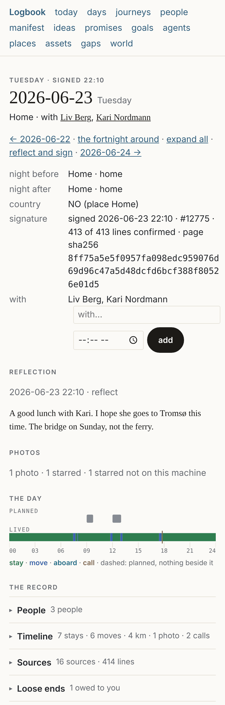

# Logbook

> The machines knew. I didn't.
>
> — [Letter 0](docs/letters/2026-10-12-why-i-built-it.md)

<p align="center"></p>

**The record.** Your phone, your photos, your calendar and your messages already keep your days. Logbook gathers them once, into one folder you hold. Nothing in it is erased. A mistake is corrected by a new line.

**How you live with it.** In the evening you open the day in a browser. It shows where you slept, where you went, who was there, and your photos. You write a few sentences about it. Then you sign it, to say you have read it.

**What never happens.** No feed, no followers, no account. No model writes your day. A model's draft is marked as a draft. Nothing leaves without your say. A page leaves only on a command you type, to a place you name, and your record keeps a line that says it left.

[Why I built it](docs/letters/2026-10-12-why-i-built-it.md) · [The manifesto](MANIFESTO.md) · [First questions](docs/faq.md)

## Try it

A month of a person who does not exist, on your own machine. On a Mac with Homebrew it is three lines; on anything else, [the install page](docs/install.md) has yours.

```bash
brew install bighydro/logbook/logbook
logbook demo --out ~/Demo/Logbook
LOGBOOK_HOME=~/Demo/Logbook logbook serve
```

The last line starts the Library: the record as pages in your browser. Leave it running and open http://127.0.0.1:8765/day/2026-06-17. Ctrl-C in the terminal stops it.

Your own record starts with `logbook setup`, one question at a time: [the first hour](docs/first-hour.md).

## Record it. Recount it. Hand a page.

- **Record it.** The exports and apps you already have, written once as lines in files you hold: photos, messages, mail, calendars, places, health, money, flights, boats.
- **Recount it.** Days, journeys, people and years, computed from those lines each time you look.
- **Hand a page.** A signed day for one person you name. They can hand theirs back.

The rules are ten, and short: [RULES.md](RULES.md).

## For builders

The format is one page, [SPEC.md](SPEC.md), in the public domain. A second program, [logbook-ts](https://github.com/bighydro/logbook-ts), was written from it, in another language. Version 1.0 waits until both read every record the same way. Start with [CONTRIBUTING.md](CONTRIBUTING.md) or [the docs](docs/index.md).

Alpha. The code is Apache-2.0; the specification is CC0.
