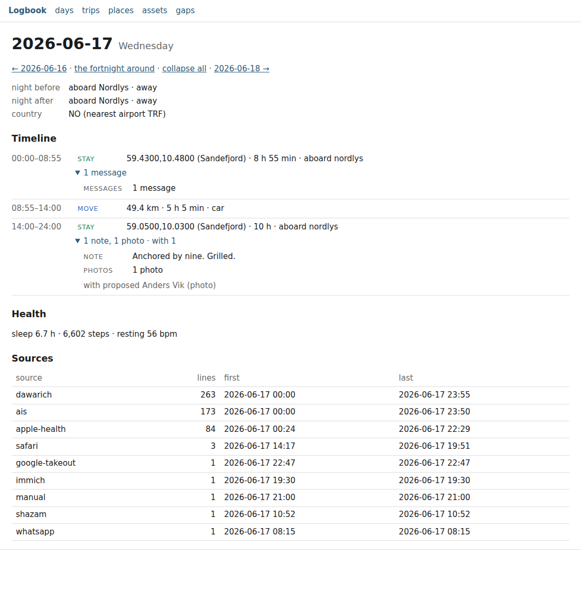

# The record in a browser

`logbook serve` reads the record in a browser, on this machine only.

```bash
logbook serve                     # http://127.0.0.1:8765/
logbook serve --port 8080
logbook serve --built             # labs: answered from pages built ahead (Built ahead, below)
logbook serve --install-service   # kept running by launchd or systemd (As a service, below)
```

It is a reader (ADR 0013) with another output: the pages are the commands' own readers rendered as
HTML instead of text, built from the index and nothing else, and nothing is written by reading. Open
the address it prints, read, close it. There is no login because there is no one to log in: the server
answers this machine and no other. Four pages ask you something and write your answer, each
through the command that writes the same thing: the Places page names the places you return to
([Places — name this place](#places--name-this-place)), a journey's page names the journey
([Journeys](#journeys)), the People page merges or tells apart who the sources saw
([People](#people)), and the Day is where you reflect on the day and sign it
([Reflect and Sign](#reflect-and-sign)), star a line and say who was there ([The Day — Star and
With](#the-day--star-and-with)). The acts, from a terminal and on the page, are on
[their own page](acts.md).



*The demo record (`logbook demo --days 30 --seed 1 --out ~/Demo/Logbook`), Wednesday 17 June: a week
aboard the yacht Nordlys. Nothing in it is real.*

## The pages

| Page | What it is | The command it renders |
|---|---|---|
| `/day/YYYY-MM-DD` | the Day as a timeline: the nights either side, the country, the signature (or `unsigned`) with the page digest, the all-day entries, the `with` row (the day's company, your word marked, and the *with…* field); your reflection; one row per stay, stop, move, flight or run aboard an asset, in time order, with the clock, the kind and what it was; each row's attachments (events, transcripts with their voices when the line has them, as the Day names them ([speakers](speakers.md)), notes, mail threads, calls, keepers named; messages by conversation, each folded; photos counted and named) and company (confirmed, then proposed) under a toggle; a star on every row that is a line; what is unplaced; the health line; the sources and when each last spoke; *Everything this day held*, every line of the day, folded ([below](#the-day--everything-it-held)); at its foot, *Reflect and sign* ([below](#reflect-and-sign)) | `logbook day`, and `logbook day reflect`, `logbook star`, `logbook with` |
| `/week/YYYY-Www` | the week: seven ribbons, one a day, each a link to its Day; where the week went (the week draft's numbers, each with its lines); each goal with what the week shows for it and the command that gives a verdict; the intention kept, in ink, and the one proposal for next week, in pencil; the stale question; the people who moved, names only; the sprint and the next trip; Hold's census, counts only; at its foot, *Close the week*: each open goal's verdict and next week's intention, one form ([the week](week.md)) | `logbook dream week`, `goal review`, `day reflect SUNDAY --intention`, `show plan`, `lab hold census` |
| `/days?from=&to=` | one row per day of the window, the day a link to its Day: the night, the kilometres moved, the flights, the stays and what attached, the people confirmed, the health triple, the usual sources with no line that day; then *Starred*, the window's stars, each linked to its row. Without a window, the record's last fortnight; a form and *earlier* / *later* links move it | `logbook show days` |
| `/trips?year=` | the trips of the year: first and last day (a link to those days), nights, route, flights in and out, places, people. Without a year, the record's last; every year the record covers is a link | `logbook show trips --year` |
| `/journeys?year=` | the journeys that began in the year, the latest first: the name or the dates (a link to the journey), the nights away, the return day, the route, the photos, the places, the people the record names, the draft folded, the evidence folded ([Journeys](#journeys)). Without a year, the record's last | `logbook show trips --year`, grown |
| `/journeys/FIRST/LAST` | one journey: its name and the form that names it, its draft folded, its stays as dots on a plain canvas and one row each, its days one row each (a link to the Day), the promises made on it, its people and photos | `logbook show trip ID` |
| `/people?year=` | the people the record names, by days together in the year (default this year), then the last real contact; below, the review queue of `people review`, the only place someone the record has not placed appears ([People](#people)) | `logbook people --year`, `people review` |
| `/people/ID` | one person: days together by year, the last real contact and what it was, drift and why, the promises open both ways, the anniversaries of the coming month, the places you have been with them | `logbook people NAME`, `people drift` |
| `/manifest?portfolio=` | the orgs you named under what you decided about them (holding, exited, passed — the anti-portfolio, each reason in full —, let go, no status), the most recent touch first, the stale ones flagged, each with its portfolio, each row's evidence folded; a filter by portfolio; below, the review queue of `review org` with its acts ([the Manifest](#the-manifest)) | `logbook show orgs [--portfolio TEXT]`, `review org` |
| `/org/ID` | one org: its refs, its status, reason and portfolio, the status form (with its portfolio), every touch newest first, its people, who introduced whom, its documents as references, every status line; the ledger only when asked (`?money=1`) | `logbook show org NAME`, `status org` |
| `/manifest/people` | the people who appear with more than one org, each with the orgs and the tier of the lines that say so; then the anti-portfolio | `logbook show orgs` |
| `/ideas` | the ideas you named by stage (build, exploring, spark, built, killed, no status), the most recent touch first, the stale ones flagged, each with its reason (a killed idea sparked again keeps its old one) and its evidence folded, the people it was discussed with counted and never named; below, the review queue of `review idea` | `logbook show ideas`, `logbook review idea` |
| `/idea/ID` | one idea: its refs, its status and reason, the status form, first said, every touch newest first, the people it was discussed with by name, its documents as references (its Notion pages, its repositories and their README), its title thread, the words by month, every status line | `logbook show idea NAME` |
| `/promises?person=` | the promises the record's own words suggest: open first, then kept, then dropped; each with who it is with, the sentence, the day it was said, the due hint and the line it was read in, linked on its Day; `/promises/ID` one promise and its evidence ([the shelves](shelves.md)) | `logbook promises` |
| `/goals` | the chapter you are in today, then your goals by horizon (life, this year, this quarter), each with its state and your latest verdict; `/goals/ID` one goal, its earlier wordings and every review ([the shelves](shelves.md)) | `logbook goal list`, `chapter list` |
| `/agents?page=&day=` | your sessions with your own agents by day, latest first, fourteen days a page: the source, the length, your words, the agent's summary, the agent's words folded ([the shelves](shelves.md)) | — |
| `/places` | the named places of `places.json` first (nights, last visit, kind, position), then *Name this place*: the review queue, twenty clusters a page, each with a dot on a plain canvas, its counts, its evidence folded, and a form that names it or rejects it | `logbook setup places list` and `setup places review` |
| `/assets` | the registered assets and the last fix of each: the time, the position, the nearest named place, the speed, how long ago | `logbook setup assets status` |
| `/gaps?since=` | where each source went quiet: lines, first and last line, the longest silence, the days with no line folded into runs | `logbook doctor sources --gaps` |
| `/world?from=&to=` | the globe you can scrub: the named places, the assets on their tracks, your stays and journeys, the chapters on the time scrubber; the page `export world` writes by default ([the world](world.md)) | `logbook export world` |

`/` is Today, the front door ([below](#today-the-front-door)). `/shelves` is the front page it replaces:
how many lines the record holds and the days it covers, and a link to each page; the gear in the
doors' header links it until `/gear` is built.
`/today` redirects to the Day of the current date in the record's timezone (`logbook.json`), the date
before until the record's `day_start` when it sets one (at 05:59 under `06:00`, yesterday's Day), whatever
the clock of the device that asks: the page to bookmark on a phone.
`/day/YYYY-MM-DD?open=1` is the Day with every toggle open, for printing or saving whole, the
conversations and *Everything this day held* among them; the page's *expand all* link is that.

Every row reads as the command prints it, because it is the same code: the grammar of a stay, a
move or a night is `logbook/core/day.py`'s and `logbook/core/days.py`'s, a trip's is `logbook/core/trips.py`'s, a
silence's is `logbook/contrib/gaps.py`'s. A number here points at the lines it came from as it does under
`--json`: hover an attachment and its line ids are the tooltip.

## Today, the front door

`/` is what you read at 07:00, on a phone first (RFC 0047 §4.1), in the frame every door shares: the
wordmark, the four doors (Today, Life, People, Places; until their own pages are built, Life opens
`/days`, People `/people` and Places `/places`), the *Ask* field (a search of the record, `/search`)
and the gear. On a phone the doors are a bar at the foot of the screen and *Ask* is at the top. Every
other page of the Library carries the same header above its own body, the door it belongs to marked
(the Days are Life's, a person People's, a place Places'); the body keeps its look until its own door
is built.

From the top:

1. **The date and where**: the day in words, a link to its Day; where you spent the night; the weather,
   when the record holds it.
2. **What's open**: the promises both ways that are still open and were said in the fortnight before
   today (in pencil: the rules read them, and they are yours to confirm; an older one is on the
   Promises shelf, never here), the task tool's tasks for the day (read, never run, tier 1 alone, as
   `show plan` reads them), and the replies owed. Seven at most, the oldest first, each a link to its
   moment; the rest is one link to the Promises shelf. Who and since when are words, never a date or a
   count beside a name.
3. **One memory**: this day a year ago, whatever it holds; else the same date in the nearest earlier
   year that holds a signed reflection, a starred photo or a trip (a flight, or a night away); else no
   card at all. One, never a list, a link to that Day, with its first sentence in your words and its
   starred photo.
4. **Reflect and sign**: the Day's own two forms, posting to the Day ([below](#reflect-and-sign)).

What's open, with nothing in it, says what fills it, in one sentence. Today is rendered live, as today's Day
is: the date, last night and the memory read a day or a few, each kept until the record or the day
moves; the promises are the fortnight's, read on the request as today's Day reads them; the plan
and the replies owed are the readings the Day's morning reads, by the same keys, read beside the page under `logbook serve` (until they have arrived, one sentence says
so, and the next visit has them; the page's tag names what has arrived). On the demo record it
answers in about 50 ms the first time and 15 ms after. A built Today (`--built`) is served only on
the day it was built. `export site` writes it as `today.html`, as of the record's last day, with no
form, no *Ask* and no font.

The frame (`logbook/contrib/doors.py`) is one stylesheet: the owner's tokens as custom properties on
`:root` (`--paper`, `--surface`, `--line`, `--line-soft`, `--tint`, `--ink`, `--pencil`,
`--pencil-rule`, `--signal`, `--signal-deep`, `--card-dark`, `--card-dark-text`,
`--card-dark-muted`), the same for a dark page, and the three families with their fallbacks
(`--serif` Instrument Serif, `--sans` Inter, `--mono` JetBrains Mono). A door's own rules read the
tokens with a fallback, `var(--paper, #F4F1EA)`, and never define `:root`.

## Three rules

Each is enforced in `logbook/contrib/serve.py` and tested in `tests/test_serve.py`.

**This machine only.** The server binds `127.0.0.1` and refuses any other host before a socket is
opened: `--host 0.0.0.0`, `::`, a LAN address, even `localhost` (a name, and a name may resolve to
anything) exit 2 naming the one host it takes. It never resolves a name, not even its own, and it
never binds anywhere else: not as a service either ([As a service](#as-a-service)), whose file never
carries `--host`. To read the record from another device, see
[reaching it from another device](#reaching-it-from-another-device).

**Who may read it.** Two readers, and nobody else: this machine, and your own phone through
Tailscale Serve once `logbook setup phone` names it ([from your phone](#from-your-phone)). Never
through Tailscale Funnel, never through any other proxy. Before it reads anything of the record,
the server looks at who asked:

- *This machine*: a request with no proxy's headers (no `Tailscale-*`, `X-Forwarded-*`,
  `Forwarded`, `Via` or `X-Real-IP`) and one
  `Host`, `127.0.0.1`, `[::1]` or `localhost` with the server's own port (`127.0.0.1:8765`), or no
  `Host` at all. Read.
- *Your phone*: a request through Tailscale Serve with one `Host`, the tailnet name the setting
  names, one `Tailscale-User-Login`, your login, and no `Tailscale-Funnel-Request`. Read, at every
  tier this machine reads. The login is a tailnet user, not a device: every device signed in as
  you reads too, so keep your login to your own devices.
- *Anything else through a proxy* (another login or none, another tailnet name, two `Host`
  headers, a Funnel request, any proxy at all while no phone is set): a `403`, nothing read.
- *Any other `Host`*: a `421`, nothing read. This is the website you happen to have open that
  points its own name at `127.0.0.1` to read your pages through your browser (DNS rebinding): it
  can choose the address, never the `Host` your browser sends, which is its own name.

A proxy that adds none of those headers and rewrites the `Host` to `127.0.0.1:8765` (nginx's
`proxy_pass` with its defaults), or a raw TCP forward, cannot be told from this machine: never put
one in front of the server.

No page can be put in another page's frame (each policy says `frame-ancestors 'none'`, each answer
`X-Frame-Options: DENY`), and a form posted from a frame or from another site (the browser's
`Sec-Fetch-Dest` other than `document`, or its `Sec-Fetch-Site` other than `same-origin` or `none`)
is refused with nothing written, with an `Origin` or without one.

**One document, nothing fetched.** A page is one HTML document with one inline stylesheet. No
stylesheet link, no frame, no script fetched; every link, form, image and tooltip points at the
server's own paths. The one font a page names is the doors' ([Today](#today-the-front-door)), in
the header every page carries: its three faces, bundled with the package under their SIL Open Font
License and served by the server itself at `/font/NAME` (every page's policy allows fonts from the
server and nowhere else, `font-src 'self'`). The one image is a Day's thumbnail of a photo, served from
`/photo/ID` out of the record's own attachment store ([below](#the-day--photos-the-track-the-line-the-week)):
the Day's policy allows images from the server and nowhere else (`img-src 'self'`), every other
page's allows none. A script is inline on three pages, each named by its hash in that page's
`Content-Security-Policy` and by nothing else: a dozen lines for the Places page's three keys; on a
Day when this machine can hear a recording, a score of lines for its *Record* button, which records
with the browser's own recorder and sends the recording with the form, never by a fetch (the policy
has no `connect-src`); and the World page's canvas, whose data are two JSON blocks a browser never
runs. Every other page's policy (`default-src 'none'`) allows no script at all. The header tells the
browser what the markup already does, so a payload that carried markup could not make a page fetch
from elsewhere even if the escaping here were wrong (every value is escaped). The test renders every
page and checks each attribute that can hold a URL, the inline style, each script and the headers.

**Read-only, but for the forms you click.** Every GET is answered from the record at its head
through the readers, and the readers never write, not even `policy/stays.json`. The test takes the
head and every file before and after serving every page and finds them the same. The writes are the
Places page's form ([below](#places--name-this-place)), a journey's name ([below](#journeys)), the
People page's review ([below](#people)), the Manifest's review and an org's status ([below](#the-manifest)),
the Ideas shelf's review and an idea's status ([below](#ideas)),
the Day's Reflect and Sign ([below](#reflect-and-sign)) and its star and *with…* ([below](#the-day--star-and-with)),
and the week's Close the week ([the week](week.md#close-the-week)),
each a POST from this machine only, each
through the command's own function, one at a time, and none waits for another writer: while another
command holds the record's writer lock (a sync running), every one of them answers the same way
rather than leaving the browser waiting: `409`, the sentence *Another command is writing to the
record; nothing was written. Try again in a moment.*, the command that holds the lock, and the form
you sent kept in a form that sends it again (*Try again*): the words you typed in their fields, the
rest as they were. Nothing is written. A recording is the one input a page cannot put back: its form
asks you to choose the file again. The server keeps the head it last saw, and for that head the
pages it rendered and what several pages read alike ([Performance](#performance)): when a sync, or
a form, moves the head while it runs, the next request brings the index to the new head first, the
kept pages and readings go, and every page reads the new lines, with no restart. That
rebuild happens once, under a lock, however many requests arrive at that moment; they wait for it
rather than each starting their own on the same file.

## Built ahead

**Labs, off by default.** `logbook serve` renders every page as it is asked for, from the index and the
record as they stand, with no limit on how long a page reads: a heavy page (People, a person, the
Manifest, the World, Promises on a record of millions of lines) takes its time and then answers.
`logbook serve --built` answers from pages built ahead of time instead, not from the record while you
wait ([RFC 0047](https://github.com/bighydro/logbook/blob/main/rfcs/0047-the-librarys-doors.md) §8);
it, or `logbook serve --build`, turns the build on for this machine, and the 06:00 close keeps it
built from then on. `--live` is still accepted and is the default. Every door and shelf (`/`, `/days`, `/trips`,
`/journeys`, `/people`, `/places`, `/world`, `/manifest`, `/manifest/people`, `/ideas`, `/promises`,
`/goals`, `/agents`, `/assets`, `/gaps`) is built, with the Days of the last fortnight and the pages
those shelves link to first (60 of each kind: the people at the top of People, this year's journeys,
the orgs, the ideas, the goals, the promises). A built page is the page the server would have rendered
at that moment, byte for byte, with one sentence added to its footer: `built 06:02`.

When it is built:

- **At the 06:00 close**, once turned on. `sync --scheduled --close` builds the Library after the sync
  and the dream and before `doctor`, and says so in one line; the demo month's first build says
  `library: 90 pages, 90 written, in 7.8 s`. A build another process holds, or one that fails, is
  that one line and never fails the run. On a machine where built pages were never turned on (no
  `pages.json` in the folder below), the close builds nothing and says `library: not built (built
  pages are off; logbook serve --built turns them on)`.
- **After every act on a page.** Reflect, Sign, a star, *with…*, a name, a merge, a status, Close the
  week: the page the act sends you back to and the front page are dropped at once, so you see what you wrote, and a
  rebuild of the rest starts in the background on a thread of its own. Acts that come while it builds
  are one more build, not one each. An act refused because the page was older than the record (409)
  drops the page its form was on, so your reload is the page as it stands.
- **By hand.** `logbook serve --build` builds now and says what it did, and which pages took longest.
  On a record of a hundred thousand lines or more it renders on several processes, one fewer than the
  machine has, four at most; `LOGBOOK_BUILD_WORKERS` sets how many (1: one process). A page that fails is named and
  the command exits 1; while another process builds it exits 75.
- **The first time.** A server started with `--built` that finds no build starts one when it starts.

What is never built: today's Day, whose shape moves with the hour (morning, live, evening; RFC 0043
§5), the redirect of `/today`, and a photo's pixels. A page no build has written (a Day a year ago, a
`/days` window you chose) is rendered when you ask for it and kept, so the next visit is a file and the
next build builds it again (the latest 500 of them). Between builds the pages are as of their build:
lines a sync appended at noon are on today's Day at once and on the shelves at the next close, or after
your next act.

A build after the first renders what changed. It keeps the line it read through, and renders every
door and the pages they link to again, but a Day only when a line landed on it or the day after, and a
journey only when it holds such a day; the rest stay as they were built. The whole-record readings the
doors share are kept beside the index and brought forward by the lines appended since, not read again:
the people of the whole record (`people.read_whole`, behind every person's page and the people review),
the promises (`promises.extract`), and each person's last real contact (`real_contacts`). Each is held
to the reading of every line by its own tests, and reads the whole record again when what was appended
is more than lines of later days: a resolution or a retraction, a line that corrects another, a
backfill into a month already read, a changed setting, or a new version of the code. A resolution,
retraction or review line, or a changed setting, also makes the next build a full one. `logbook serve
--build --full` renders every page whatever the last build left, and is never needed in normal use.
On a sealed record these readings, and the review pages' tables of observed people, orgs, ideas, assets
and places, are kept in the process's memory for its life instead, never on this disk, unless
`plaintext_cache` is on ([sealing](sealing.md)): a server reads the whole record once after it starts.

Where: `library/` beside the index, in the cache folder (`~/Library/Caches/logbook/<owner_id>/` on
macOS, `~/.cache/logbook/<owner_id>/` on Linux, `%LOCALAPPDATA%\logbook\cache\<owner_id>\` on
Windows), never in the record's folder. No export, vault, crossing or copy of the record carries it,
and nothing in it is a line. The folder is `0700` and every file `0600`: the pages hold what the
Library shows, every tier of it, so only the record's user reads them. A file is named by the SHA-256
of its address, so no address becomes a path
and two addresses that differ only in case are never one file. Deleting the folder loses nothing: the
next build writes it again, and with no `pages.json` the close builds nothing.

**A sealed record builds nothing.** On a sealed record (recipients in `logbook.json`), no built page
is kept on this disk in plain text, not even one of tier 1, which still names who is who from the
resolutions (tier 2): `logbook serve --built` renders every page as it is asked for, reads each to its
end as live does, and says so when it starts; `logbook serve --build` refuses in one sentence (exit
2); the close says `library: a sealed record keeps no built page on this disk, …`; and a build left
from before is removed, unless another process is building it then (the next build removes it). The
pages a running server keeps are in its memory and go when it stops. To build
anyway, set `"plaintext_cache": true` in `logbook.json` (off by default): the built pages, and the
readings kept beside the index (above), are then on this disk in plain text, `0600`, as on a record
that seals nothing ([sealing](sealing.md); RFC 0047 §15, question 11).

Not yet, and why it is a lab (after v1; nothing here is built now):

- [ ] **A rebuild through its own Site.** The rebuild after an act renders through the server's own
  `Site`, and can save a page's stale bytes again; each such save adds another `built hh:mm` to its
  footer, and marks the page `asked`. It should render through a `Site` with no library.
- [ ] **A page older than the record's head.** A built page is never checked against the record's
  head. After `day sign` on the command line, the built Day says *unsigned* until the next 06:00 close.
  A built page whose head is not the record's should still be served, and start one rebuild per head,
  so acts and syncs from the command line are on the pages within one build.
- [ ] **Two writers of `pages.json`.** The server's rebuild and the close's build can each lose the
  other's writes to the manifest. The server should write it only under the build lock.

## Never hangs

The server keeps answering, whatever a page costs and whatever else writes the record.

- **A page has a limit.** A page the build does not hold is read in a pool of two: however many are
  asked for together, at most two are read at once, so a whole menu opened at once never holds the
  record in memory a dozen times over. Live, the default, a page has no limit unless `--limit SECONDS`
  gives one: a heavy page takes its time and answers. Given one, or with `--built` (15 s unless
  `--limit` says otherwise; `--limit 0` is none), a page read longer is stopped and answered with one
  sentence (*Still reading*, a 503): with `--built` it is being built in the background and will be
  here as a file in a few minutes, and every other door opens as usual; live, the sentence says the
  reading was stopped. A page the build holds never waits for the pool.
- **A browser that leaves stops its reading.** The server looks at the connection while the page is
  read; when the browser closes it, the reading stops at the next line it reads, and nothing is sent.
  A broken pipe is a browser leaving, never a traceback in the log. A connection that sends nothing for
  60 s is closed.
- **A reader never waits on a writer.** A sync appends a line, then `logbook.json`, then the index
  (SPEC §3). A page read in between finds the index a line short: it reads the record up to the last
  line the index holds, every line of it whole, and names that head in its tag. It never rebuilds the
  index from under the writer.
- **A server that says nothing is restarted.** `serve --status` tells a server that answers, one that
  takes the connection and says nothing for 5 s (`not answering`: stuck, or paused by the system),
  and nothing at all apart, and names the command that restarts it. The server asks itself for its
  icon every 30 s; two silences in a row, and it writes every thread's stack to its log and exits 70,
  which the service manager starts again (launchd's `KeepAlive`, systemd's `Restart=on-failure`). A
  process the system paused runs nothing, its watchdog included: the scheduled run (`sync
  --scheduled`, four times a day) restarts it, `launchctl kickstart -k gui/<uid>/org.logbook.serve`
  or `systemctl --user restart logbook-serve`, in one line. A system-domain service is restarted by
  an administrator, and the line says how.
- **When it does hang anyway**, `kill -USR1 <pid>` writes every thread's stack to the log
  (`~/Library/Logs/logbook-serve.log` on macOS, the journal on Linux) while the server runs on: send
  it, and the log says where it waits.

## Performance

A Day is one `day.read`: one reading of the day and the day before through `index.sqlite`, the
health lines of the two days by an indexed column, nothing swept. On the demo record a Day answers in
tens of milliseconds, a month of `/days` in under half a second; on a record of millions of lines a
Day still renders in under a second, because the index locates the day's lines and only they are
read ([docs/day.md](day.md), *Performance*). The conversations and *Everything this day held* come
from that same reading: a synthetic day of 3,000 messages across 40 conversations, 400 mails and 200
Notion events renders in about 0.4 s into a page of 2.3 MB (`tests/test_day_page_everything.py`
holds it under 8 MB). `/days` reads the window in chunks of a month, as the
command does; a year is a dozen readings. The airports table is loaded once, when the server starts.

A reload at the same head costs nothing. Every page that is the record's and nothing else (`/`, a
Day, `/days`, `/trips`, `/places`, `/world`, the journeys, the people) carries an `ETag`: the first
twelve characters of the head, then a digest of the request and of what else the page reads (the
rest of `logbook.json`, `places.json`, `assets.json`, `policy/`, `state/places-review.json`, the
pages received from the circle) and of the server's start; a Day's also of the day you are in, since
its forms are there from that day on, and the People pages' of the record's today, since this year,
the coming anniversaries and a silence move with it. It is sent with `Cache-Control: no-cache`, so
the browser keeps the page and asks every time; when the tag it sends back is the page's, the
answer is a `304` with no body and nothing is read or rendered. A sync
that moves the head, a place renamed or a restart changes the tag, and the next reload is the page
again. `/assets` and `/gaps`, which the clock moves (the age of a fix, a silence that runs to now),
and every error carry no tag and `Cache-Control: no-store`, as before.

The server keeps what the browser may keep. A page with a tag is kept by it, so a second request for
it, from this browser or another, is answered without reading anything: the same tag is the same
page, as the `304` already says. It keeps the last 64 pages asked for, 64 MB at most, and drops them
all when the head moves. What several pages read alike is read once for the record as it stands —
the head, the settings beside the chain that the tags digest, and the day — and handed to each of
them until it moves (`Site.shared`): the people of the whole record, their last real contacts and the
promises open today, for every person's page; the year's ranking and the review queue of `/people`;
the orgs and their review queue for the Manifest, an org's page and `/manifest/people`; the ideas and
theirs for the Ideas pages; the promises; the sessions with an agent; and the index's counts behind
`/gaps`, whose clock is read again on every request. Requests that ask together wait for one reading.

A journeys page is one reading of its year and a month either side, and a journey's page one
reading of its days and a week either side, as `show trip` reads it; the People page is `people`
over the year and the review queue's table, built once per head; a person's page reads the whole
record's people once, and every other person's page is read from that. On the four synthetic years
of the tests each answers in about a fifth of a second.

What a page reads, it reads through `index.sqlite`, and never sweeps the files. A night is found by
bisection over the owner's stays (`stays.Nights`), not by reading every stay of the record once a
day; the people review compares an observed person only with the people who share an address, a
number or a word of a name with them; the promises and the sessions with an agent stream the
messages, one line at a time, and keep only what they show. The pages that read the whole record —
the People pages, the Manifest, the Promises and Agents shelves, the World, the Places review —
still read it once for each head: the first of them after a sync, or after the server starts, takes
the time those lines take to read (minutes, on a record of millions), and every page after it at
that head, a second.

### Measured

`scripts/bench_library.py` builds a synthetic record of ten years shaped like a real one (55%
messages, 15% mail, 15% location fixes, 8% photos, the rest calendar, notes, Notion, Drive, calls
and transcripts, sessions with an agent; a few hundred people, a few thousand handles; orgs, ideas,
goals, signed days, stars), indexes it, and times every route in a process of its own: **cold** is
the first request after the server starts, **warm** the second, **after append** a third once one
line has been appended (a sync: the head moves). Seconds, and the process's peak memory:

```bash
uv run python scripts/bench_library.py --lines 1000000 --root ~/bench-1m --markdown
```

Measured on a 4-CPU cloud container (Intel Xeon at 2.8 GHz, 15.7 GB, Python 3.12, SQLite 3.45),
before this change (0.7.0) and after it, with other benchmarks running beside it. A request runs on
one core, so the CPU count does not change these numbers, and a laptop core of today is no slower
than one of these: the times are held to the targets (a second warm, five cold) as they are, not
scaled. A route's id is the busiest person, the first org and idea, the busiest day of the last
year. "Out of memory" is the container's limit (about 11.7 GB) reached, the request killed.

Each cell is before → **after**; "warm" after is the page the server kept (a millisecond),
"after append" the first request once the head has moved, which reads again what the page needs.
`/`, `/trips` and `/world` at a million lines were timed again, old and new code one after the other
on the same page cache, because a first pass ran beside the five-million runs. The first time the
Library opens an index built before this change, it adds the two new indexes, once: 1.3 s at a
million lines, 5.2 s at five million. The Library builds them on a page it serves (a GET), under the
record's writer lock taken without waiting, and lets it go once they are built: never by a writer,
never while a writer holds the lock (a `sync` that arrives meanwhile waits on the lock, saying so in
its one line, and then appends, as one of the Library's own acts sent meanwhile waits for them; one
already writing means the next head tries again).

**1,000,000 lines** (before → after, seconds)

| route | cold | warm | after append | peak |
|---|--:|--:|--:|--:|
| `/` | 0.75 → **0.18** | 0.16 → **0.00** | 0.16 → **0.17** | 40 MB → 41 MB |
| `/today` | 0.00 → **0.00** | 0.00 → **0.00** | 0.00 → **0.00** | 39 MB → 41 MB |
| `/day/DAY` | 0.14 → **0.14** | 0.13 → **0.00** | 0.14 → **0.17** | 48 MB → 48 MB |
| `/days` | 0.76 → **0.49** | 0.77 → **0.00** | 0.69 → **0.35** | 62 MB → 63 MB |
| `/trips` | 7.79 → **5.93** | 7.89 → **0.00** | 7.76 → **5.29** | 428 MB → 428 MB |
| `/journeys` | 10 → **6.38** | 10 → **0.00** | 10 → **5.86** | 469 MB → 469 MB |
| `/journeys/START/END` | 1.53 → **0.43** | 0.71 → **0.00** | 0.66 → **0.43** | 65 MB → 64 MB |
| `/people` | 189 → **85** | 155 → **0.00** | 201 → **72** | 458 MB → 456 MB |
| `/people/ID` | 251 → **108** | 210 → **0.00** | 212 → **107** | 2.3 GB → 375 MB |
| `/manifest` | 37 → **38** | 17 → **0.00** | 38 → **38** | 178 MB → 172 MB |
| `/org/ID` | 17 → **17** | 18 → **0.00** | 36 → **36** | 170 MB → 170 MB |
| `/manifest/people` | 18 → **17** | 17 → **0.00** | 18 → **17** | 173 MB → 173 MB |
| `/ideas` | 6.05 → **3.93** | 2.74 → **0.00** | 5.60 → **4.16** | 96 MB → 91 MB |
| `/idea/ID` | 2.55 → **1.74** | 2.64 → **0.00** | 5.51 → **4.05** | 96 MB → 91 MB |
| `/places` | 9.85 → **9.71** | 0.01 → **0.00** | 9.73 → **11** | 299 MB → 299 MB |
| `/assets` | 0.10 → **0.00** | 0.09 → **0.00** | 0.09 → **0.00** | 41 MB → 41 MB |
| `/gaps` | 4.23 → **4.35** | 4.29 → **0.06** | 4.33 → **4.26** | 50 MB → 51 MB |
| `/world` | 63 → **51** | 62 → **0.00** | 62 → **53** | 617 MB → 616 MB |
| `/promises` | 67 → **61** | 65 → **0.00** | 64 → **56** | 2.3 GB → 56 MB |
| `/goals` | 0.00 → **0.00** | 0.00 → **0.00** | 0.00 → **0.01** | 39 MB → 41 MB |
| `/agents` | 15 → **14** | 14 → **0.00** | 15 → **13** | 1.7 GB → 56 MB |

**5,000,000 lines** (before → after, seconds)

| route | cold | warm | after append | peak |
|---|--:|--:|--:|--:|
| `/` | 6.55 → **3.15** | 1.00 → **0.00** | 0.83 → **1.24** | 43 MB → 46 MB |
| `/today` | 0.00 → **0.00** | 0.00 → **0.00** | 0.00 → **0.00** | 40 MB → 46 MB |
| `/day/DAY` | 0.66 → **0.67** | 0.50 → **0.00** | 0.47 → **0.64** | 70 MB → 75 MB |
| `/days` | 8.28 → **2.29** | 2.48 → **0.00** | 2.46 → **3.01** | 143 MB → 143 MB |
| `/trips` | 44 → **41** | 44 → **0.00** | 40 → **38** | 1.9 GB → 1.9 GB |
| `/journeys` | 50 → **39** | 45 → **0.00** | 43 → **37** | 2.1 GB → 2.1 GB |
| `/journeys/START/END` | 3.77 → **2.06** | 3.60 → **0.00** | 3.80 → **1.99** | 152 MB → 149 MB |
| `/people` | 591 → **502** | 359 → **0.00** | 519 → **354** | 1.8 GB → 1.8 GB |
| `/people/ID` | out of memory → **522** | out of memory → **0.00** | out of memory → **522** | – → 1.6 GB |
| `/manifest` | 198 → **187** | 94 → **0.00** | 187 → **187** | 698 MB → 700 MB |
| `/org/ID` | 83 → **87** | 81 → **0.00** | 178 → **188** | 642 MB → 649 MB |
| `/manifest/people` | 92 → **91** | 92 → **0.00** | 95 → **91** | 688 MB → 688 MB |
| `/ideas` | 27 → **20** | 12 → **0.00** | 29 → **20** | 307 MB → 278 MB |
| `/idea/ID` | 13 → **8.32** | 13 → **0.00** | 27 → **20** | 305 MB → 276 MB |
| `/places` | 48 → **46** | 0.00 → **0.00** | 46 → **47** | 1.3 GB → 1.3 GB |
| `/assets` | 0.50 → **0.00** | 0.58 → **0.00** | 0.54 → **0.00** | 41 MB → 41 MB |
| `/gaps` | 22 → **23** | 23 → **0.06** | 23 → **22** | 52 MB → 52 MB |
| `/world` | 295 → **280** | 280 → **0.00** | 280 → **293** | 2.8 GB → 2.8 GB |
| `/promises` | 497 → **293** | 480 → **0.00** | 431 → **277** | 11.2 GB → 86 MB |
| `/goals` | 0.01 → **0.00** | 0.01 → **0.00** | 0.00 → **0.00** | 39 MB → 41 MB |
| `/agents` | 119 → **68** | 88 → **0.00** | 99 → **64** | 8.5 GB → 96 MB |

Warm, every page answers within a millisecond at any size (`/gaps` reads its clock again: 0.06 s).
Cold — the first request after the server starts, or after a sync — is under five seconds at five
million lines for the Day, `/days`, a journey's page, `/`, `/assets` and `/goals`; the pages that read a
year (`/trips`, `/journeys`) take tens of seconds, and those that read the whole record minutes, once
for each head. Keeping their readings across a restart, and growing them with each sync instead of
reading again, would bring those under a second too; it would put what they read of the sealed lines
in a file beside the index, which is the record's owner's to decide: on a sealed record they stay in
memory unless the owner sets `plaintext_cache` ([sealing](sealing.md)).


The server is the standard library's (`http.server`, one thread per request); it is meant for one
reader on one machine, not for a crowd.

## As a service

```bash
logbook serve --install-service                # as you: a launchd agent, or a systemd user service
logbook serve --install-service --port 8080
logbook serve --install-service --system       # a machine nobody logs in to: prints two sudo commands
logbook serve --status                         # installed? answering? (exit 0, 1, 3)
logbook serve --uninstall-service [--system]
```

`--install-service` keeps `logbook serve` running, so the pages are there in the morning without a
terminal open. The service runs the Python that installed it (`sys.executable -m logbook.cli serve
--port N`, no PATH assumed) on the record this command found (`LOGBOOK_HOME`, and
`LOGBOOK_IDENTITY_FILE` when it is set, so a sealed record's pages open as they do by hand: paths,
never a key). It starts at load, is started again whenever it fails, and its output goes beside the
sync log. As with the schedule ([docs/schedule.md](schedule.md)), the plist or unit is printed
before it is written and nothing is written outside the one directory; the file comes from the same
renderer as the schedule's.

| | macOS | Linux |
|---|---|---|
| without `--system` | a launchd agent, `~/Library/LaunchAgents/org.logbook.serve.plist`, loaded now and at every login | a systemd user service, `~/.config/systemd/user/logbook-serve.service`, enabled and started now; from boot when you linger (`loginctl enable-linger`), else with your session |
| with `--system` | a launchd daemon that runs as you (`UserName`) from boot: `/Library/LaunchDaemons/org.logbook.serve.plist` | a system service that runs as you (`User=`) from boot: `/etc/systemd/system/logbook-serve.service` |
| its output | `~/Library/Logs/logbook-serve.log`, beside `logbook-sync.log` | `journalctl --user -u logbook-serve.service`; with `--system`, `journalctl -u logbook-serve.service` |
| started again | `KeepAlive` when it exits unsuccessfully | `Restart=on-failure`, five seconds later |

**The record's home.** The machine that keeps the record (ADR 0022) is often run by a dedicated user
that never has a login session, and an agent cannot load in a session that never starts. That is
what `--system` is for: run as that user, it writes the daemon to the home directory and prints the
two commands that install it, which you run as an administrator. It never runs `sudo` itself, and it
refuses to run as root (the daemon would run as root, with root's home):

```
$ logbook serve --install-service --system
writing /Users/ines/org.logbook.serve.plist:
…
written: a launchd daemon running `logbook serve --port 8765` as ines from boot, started again when it fails; nothing runs until you install it, as an administrator:
  sudo cp /Users/ines/org.logbook.serve.plist /Library/LaunchDaemons/org.logbook.serve.plist
  sudo launchctl bootstrap system /Library/LaunchDaemons/org.logbook.serve.plist
then http://127.0.0.1:8765/ (/today is today's page); its output: ~/Library/Logs/logbook-serve.log; …
```

Run again over a daemon already installed, it prints `sudo launchctl bootout system/org.logbook.serve`
first; on Linux it prints the copy, `systemctl daemon-reload` and `systemctl restart` in place of the
copy and `systemctl enable --now`. `--uninstall-service --system` removes the copy in the home
directory and prints the two commands that stop the service and remove the system's copy.

**Is it up?** `logbook serve --status` lists the serve services installed here, the user's and the
system's, the port each runs on, and whether a logbook server answers there: exit 0 when every one
answers, 1 when one does not (with where its output goes), 3 when none is installed. The question is
one `HEAD /favicon.ico` to 127.0.0.1, which reads nothing of the record. `logbook doctor` asks the
same in its `serve` line: a pass when no service is installed or when it answers, a warn when it is
installed and silent, or when two share one port.

**After a sync** nothing needs restarting: the next page reads the new head (see *Read-only* above),
and a phone's reload of a page whose head has not moved is a `304`.

### Reaching it from another device

The server binds 127.0.0.1 and nothing else, as a service as by hand; no flag changes that. Reading
the pages from a phone or another machine is your business, done on this machine's terms and by a
tool you choose:

- **an SSH tunnel** from the other device: `ssh -L 8765:127.0.0.1:8765 <this machine>`, then
  http://127.0.0.1:8765/ there. The same port on both ends: the browser names the port it opened in
  its `Host`, and the server reads only for its own (`ssh -L 8766:127.0.0.1:8765` is a `421`);
- **Tailscale Serve** on this same machine, `tailscale serve --bg 8765`, with `logbook setup phone`
  naming the phone and your login ([from your phone](#from-your-phone)): the pages over the tailnet
  only, with its certificate, to that one login.

Nothing else reads them. Another proxy (Caddy, nginx, a tunnel service, Tailscale Serve without the
setting, Tailscale Funnel ever) is refused, a `403` with nothing read ([who may read
it](#three-rules)). The pages carry every tier the record holds (SPEC §4): the server reads them all
because nothing it serves leaves the machine. Keep the tailnet to your own devices.

## From your phone

Off by default. With one setting, behind Tailscale Serve, the phone reads every page and writes too:
Reflect, With, Star and Sign on the Day, and the shelves' forms, each as from this machine. Without
it, the phone reads nothing: every request through a proxy is a `403`.

On the machine that serves the record (the Air):

```bash
tailscale serve --bg 8765        # https://server.tail1234.ts.net/ on your tailnet → http://127.0.0.1:8765
logbook setup phone --origin https://server.tail1234.ts.net --login ines@example.org
```

`tailscale serve --bg 8765` puts the Library behind HTTPS on your tailnet, with the machine's own
certificate, and keeps it there across restarts; tailscaled forwards each request to
`127.0.0.1:8765`, so it reaches the server from loopback. It is not `tailscale funnel`, which would
put the pages on the internet: never funnel this port. The origin is the address the phone opens,
`https://` and the machine's tailnet name, nothing after it. The login is yours on the tailnet:
`tailscale status` on the Air lists each device with the login it is signed in as (or
`tailscale whois` with the phone's tailnet address, or the admin console's Users page). `setup
phone` prints what it will write to `logbook.json`, asks for a yes typed at a terminal, and writes
nothing else; the server reads it with each request, so no restart. `logbook setup phone` alone says
what is set, `--off` removes it, and `logbook doctor` names the origin on its `phone` line (the
login shortened). Before you travel, star a line from the phone at home: a `303` and the star.

What it allows: a page read when tailscaled forwards it from your phone with one `Host`, the
setting's host, one `Tailscale-User-Login`, your login, and no `Tailscale-Funnel-Request`; and a POST
that tailscaled forwards from your phone, all at once: from loopback, with
the browser's `Origin` exactly the setting's (the host in any case, `:443` written or not), the
`Host` the setting's host, and `Tailscale-User-Login`, the header Tailscale Serve sets from the
device's tailnet identity, exactly your login, each header sent once, and not from inside a frame
(`Sec-Fetch-Dest`, when the browser sends it, is `document`). Then the busy `409`, one write at a
time, the CLI's own functions, the same headers: everything as from this machine.

What stays refused, a `403` with nothing written: any other device or user on the tailnet (another
login, or none: a tagged device and a Funnel request carry no login), another tailnet name, `http://`,
another port, `Origin: null`, a page on another site in the phone's browser (its own origin), a form
posted from a frame. Without the setting, the phone's forms are refused as they always were, and
the refusal says what would allow them.

A program on the tailnet is refused too. Behind Tailscale Serve every request arrives from
loopback, so the server tells this machine's own requests from a proxy's by what the proxy adds: a
request is *proxied* when its `Host` is not `127.0.0.1` or `[::1]` (any port; `localhost` is a
name, not one of them) or when it carries any `Tailscale-*` or `X-Forwarded-*` header. A proxied
POST is answered only as the phone's, through the checks above, and never because it carries no
`Origin`: `curl` from any device on the tailnet, with no Origin or a login it typed, is a `403` with
nothing written, the setting on or off. Requests to `http://127.0.0.1:8765` or
`http://[::1]:8765` from this machine are answered as before; a form posted to any other host,
`localhost` included, is treated as coming through a proxy, so a form posted to
`http://localhost:8765` is refused unless it is the phone's (the page itself reads there). That rests on tailscaled sending the tailnet name as `Host`
and adding its `X-Forwarded-*` headers, as Tailscale Serve does today; the star from the phone
before you travel confirms the first, and a `curl` from another device that comes back `403` the
second. Keep the tailnet name to your own devices all the same (every tier is on the pages it
serves), and never `tailscale funnel` the port. Serve it as HTTPS, `tailscale serve --bg 8765`, never
as a raw TCP forward (`tailscale serve --tcp`, or any port forward): a forward adds no header and
keeps the client's own `Host`, so the server could not tell another device's request from this
machine's. The policy's `write` list (the MCP door, ADR 0022)
is not this and is never read here; ADR 0024 records the change.

## Places — name this place

`/places` is two things. First the named places of `places.json`, as `setup places list` prints them,
each with the nights the record has spent there and the last visit (from the observed places, below).
Then **Name this place**: the review queue of `logbook setup places review`
([places](places.md#review)), the places you return to that have no name yet, in the same order (by
nights, then hours), twenty a page with *more* at the foot. Each cluster shows

- a dot on a plain canvas, drawn by the server: the spot, the radius naming it would write, and the
  nearest named place where it lies or at the edge in its direction, with its name and distance. No
  tile, no map host, nothing fetched;
- its facts, the line the CLI prints: the coordinates, visits, nights, hours, first and last visit,
  the asset it was aboard, the nearest named place;
- its evidence, folded as the CLI folds it: the addresses one source wrote along one street are one
  line (`dawarich: "Plattformveien" (38 addresses, 217 stays)`), three lines are shown, and *… and
  N more* opens the rest;
- a field prefilled with the name the evidence weighs most (blank where no source names the spot),
  and three acts: **Name** writes the field, **Skip** moves to the next cluster, **Not a place**
  rejects it.

Keys, when the cursor is not in the field: Enter names, `n` is not a place, Space skips; Escape
leaves the field. The keys act on the cluster at the top of the window. They are the page's one
script, inline; without it the buttons and links do the same.

**One path.** Name and Not a place post to `/places/review`, and the server answers through the
review engine's own `accept` and `reject`, the code `setup places review --name`, `--accept` and
`--reject` run: `places.json` gets the place at the cluster's centre with its fitted radius, the
record gets the naming as one `note/v1` line through `Logbook.append`, and a rejection is one
`entity-review/v1` line, its cache in `state/places-review.json`, byte for byte what the CLI writes.
There is no second implementation.
After a write the head has moved, and the page you come back to is read again: the named place in
the table, the queue one shorter, the next cluster scrolled to. A form from a page older than the
record, naming a cluster that is gone, is refused (409) and nothing is written; so is a name the
engine refuses (400: already a place, no name given), with the reason on the page.

**This machine only.** This is the Library's first write act, and it is allowed because the server
binds 127.0.0.1 and runs as the record's own user: whoever can reach the form can already run
`setup places review` in a terminal here. The server holds it to that: a POST is answered only when
the connection comes from this machine (the client address is loopback, `127.0.0.0/8` or `::1`) and,
when the browser sends an `Origin` header, it names `127.0.0.1` or `[::1]` (the server's own pages,
as reached from here; not `localhost`, a name, and not another scheme or host). A request that came
through a proxy (its `Host` not `127.0.0.1` or `[::1]`, or a `Tailscale-*` or `X-Forwarded-*`
header) is answered only as the owner's phone (*From your phone*). Anything else is a `403` and
nothing is written. Every page is sent with `Referrer-Policy: same-origin`, so the browser
names the page a form came from (`Origin: http://127.0.0.1:<port>`) and sends nothing to other sites
(under `no-referrer` it would send `Origin: null`, and every form would be refused). Through an SSH
tunnel the browser's origin is `127.0.0.1` and the form works; behind any proxy but Tailscale Serve
with `logbook setup phone` naming the phone (*From your phone*) the page is not read at all. `GET /places/review` is a `405`.

**A Day's stay without a name** carries a small *name this place* link to the Places page at its
cluster (`/places?at=lat,lon`, which redirects to the page the cluster is on and scrolls to it, or
says there is nothing to name there when the spot is named, rejected, or was never a stay). A stay
inside a named place prints its name at once, as before.

## Reflect and Sign

At the foot of every Day (the pager's *reflect and sign* goes there; `/today` is the page to keep on
a phone) are the two acts that close a day, the two `logbook day reflect` performs at the command
line ([the signed day](signed-day.md#closing-the-day-by-voice)).

**Reflect.** A field for a few sentences in your words. When the day has a Wispr Flow dictation
that begins with *reflect* and no reflection was taken from it yet, the field holds it without that
word, under a line naming the dictation: a draft, and nothing is written by showing it. Reflect takes
it as it stands or as you changed it, as `day reflect`'s *y* (or *e*) does: the note keeps the
dictation's id under `extra.dictation` and the moment you spoke as its `at`. Otherwise the field
holds the reflection on the day, when there is one, so a word misheard is mended in place; the same
words are never written twice. Reflect writes one `note/v1` line, label `reflection`, source
`reflect`, tier 2, through `reflect.write`, the function `day reflect --text` calls: the command's
line, byte for byte. The field's `lang` is the language most of the day's own words are in, by the
rule the dream uses to say which language to write in (`dream.language_of`), so a phone's keyboard
and its spelling follow you.

**Or say it (optional).** Where this machine can hear, a second form takes a recording: a file, or
on a phone the recorder the browser opens for it. Where the browser can record (it has
MediaRecorder; the page is on 127.0.0.1, or on your phone behind Tailscale Serve, since a browser lends the
microphone to a secure origin only), a *Record* button records from the microphone and sends the
recording with that form when you press it again; that is the Day's one script. The recording goes
up as the form's file (`multipart/form-data`, at most 64 MiB, half an hour of speech even as WAV),
is written to a temporary folder, heard through the path of `day reflect --audio` (the local whisper
engine of `openlogbook[transcribe]`, the hub offline, never fetching a model), deleted, and its words
written as the reflection, `extra.heard_by` naming the engine and model, as the command writes it.
Whether this machine can hear is asked once, when `serve` starts: without the extra, or without the
model (`logbook day reflect DAY --audio FILE --fetch-model` fetches it once, then restart `serve`),
the page says which in place of the form. Typing always works.

**The proposals.** With a reflection on the day, the rules read it as `day reflect` does
(commitments, delegations, and what became of the commitments on the page: kept, missed, dropped,
carried), and each proposal is a box, numbered and worded as the command prints it. None is ticked:
each is a guess until you tick it. The reflection, a sentence a line, is folded beside them, so
*line 6* reads.

**Sign.** Sign signs the day through `reflect.close`, the code `day reflect --sign` runs: under one
hold of the writer lock, the ticked delegations are written as notes, then `signing.sign` writes the
`signed-day/v1` line with the lines confirmed (every line on the page but pencil, your reflection and
the delegations among them; [signed day](signed-day.md#keep-and-sign)), the ticked dispositions, and the moment you clicked. It is byte for byte the
line `logbook day reflect DAY --sign --accept N,N` writes for the same reflection and the same
ticks. Nothing ticked accepts nothing. A day you signed before shows *Sign again* and what the new
signature keeps from the standing one (its confirmed lines still on the page, its dispositions, an
accepted one winning on a line they share, its note); the new line carries `supersedes`, as RFC 0034
has it. Afterwards the section opens with the signature as `day sign` prints it, and the Day's
*signature* row says when, which line, how many lines it confirmed of the page's, and the page
digest whole (`page sha256 …`), with `, the page has changed since` once a line is added to the day.

**One path, this machine only.** The forms post to `/day/YYYY-MM-DD/reflect` (Reflect, the recording,
and the evening's *Dream the day so far*) and `/day/YYYY-MM-DD/sign` (Sign, and Keep and sign below),
held to the Places page's rule: a loopback client and, when the browser sends
one, an `Origin` of `127.0.0.1` or `[::1]`, else `403` and nothing written; a GET of either is a
`405`. Nothing is written without the click: reading the page offers the draft and shows the boxes,
and writes nothing. A form older than the record is refused, `409` and nothing written: a Sign whose
reflection is no longer the latest or whose proposals changed since the page was read, a draft that
is no longer on the day. Sign with no reflection on the day is refused with the two ways on (reflect
first, or `logbook day sign DAY` without one), a day ahead of today has no forms, and a word the
command refuses (an empty reflection, a number no proposal has) is a `400` with its reason. The page
never waits for another writer: while a sync holds the record it says so (`409`, the one answer
[above](#three-rules)), keeps your words, and you click *Try again*. Every write in the server is one at a time.

**Not the door.** The page reads `policy/crossing.json` for the entries that say which drafts it shows
(`dream`, and `relationship` for a person's) and whether *Dream the day so far* is offered, never its
`write` list: this is not the MCP door
(ADR 0022), and that list may stay empty. The Library is your own Sign path, on your own machine. The
Purser, the orchestrator that builds the Day page elsewhere and carries your verdict back through
`sign_day`, remains an alternative front door, open only when you name the tool in that list
([the signed day](signed-day.md#signing-through-the-door)).

**The footer** of every Day says *No model touched this page. What a model drafted is marked as a
draft.* It is true because the rows are computed by the readers and the proposals by rules, and the
one thing a model writes about a day, the dream's draft, is headed *Draft* with the model's name and
every unsupported sentence marked.

## Keep and sign

In the evening shape of a Day (today after the evening hour, or a past day not yet signed) and when a
signed day is signed again, the Sign form is Keep and sign (RFC 0043 §5): what you keep of the day,
answered in one form and written in one POST to `/day/YYYY-MM-DD/sign`, under one hold of the writer
lock, before the signature. Every control is a flag of the command, and the page and the command write
the same lines, byte for byte, but for the line ids and the clock:

| On the page | At the command line | What it writes |
|---|---|---|
| a box on a sentence or a link of the pencil, numbered `keep N` | `--keep N,N` | a `note/v1` labelled `learned`, `decision` or `idea`; a link's `entity/v1`; the photo of the day's star and its note |
| *revisit on* beside a decision | `--revisit N=YYYY-MM-DD` | the kept decision's `extra.revisit`, a day after the day signed |
| *the day in a word* | `--word WORD` | a `note/v1` labelled `word`, one on a day |
| *done*, *tomorrow* or *let go* on a task of the day, shown by its title alone | `--done T,T`, `--tomorrow T,T`, `--let-go T,T` | a `note/v1` labelled `task` for each task answered |
| a box on a delegation (the proposals, as above) | `--accept N,N` (`day reflect --sign`) | the delegation's `note/v1` |
| *Sign*, *Sign again* | `logbook day reflect DAY --sign` | the `signed-day/v1` line, the kept lines among those it confirms, never the draft |

So `logbook day reflect 2026-10-20 --sign --keep 2,3,4 --revisit 4=2026-11-20 --word calm --done 1
--let-go 2 --accept 1` is the same click, and `logbook day sign 2026-10-20 --keep 2,3,4 --revisit
4=2026-11-20 --word calm --done 1 --let-go 2` the same without the delegation. The numbers are the
command's: `logbook day DAY` prints `keep N` at the end of each keepable row and `logbook show plan DAY`
numbers the day's tasks. The page shows no task number: a task is its title alone, since a title may
open or end with a name and a number never sits beside one, and its field carries the task's Notion
id, which the server numbers as `--done` takes it under the lock; the lines written are the
command's. A sentence of the pencil is in pencil (graphite on paper) until you keep it,
then in ink with the line it became, and no box: a re-sign keeps it and never writes it twice. A task
answered already says how; the day's word, once kept, stands. Nothing chosen writes nothing: a task
with no answer is no line, an empty word no word. The tasks are the plan's as `show plan` reads them
(tier 1 alone), read beside the page on `logbook serve`; until they are read the form says so.
Through a page's tier gate (a Site that reads fewer tiers than the record holds), the pencil kept from
is the draft that gate shows, as the rest of the Day reads it: a draft above the gate is neither shown
nor offered, and a form that names one anyway keeps nothing of it, since `keep.prepared` reads the
draft through the same gate. So with the day in a word, a note of tier 2: above the gate it is absent
from the page, and the refusal of a second word says the day has one without quoting it.

Every item is checked before the first line is written, by the code `--keep` runs (`keep.prepared`),
and any refusal writes nothing and is a `400` in one sentence: a number the pencil does not give, an
event (`--accept` writes those), a sentence that rests on no line, a revisit day that is not a later
day or not on a kept decision, two words or a number for the word, a task that is not the day's or
is answered already (named by its title). A
form older than the record is a `409` with nothing written: a pencil dreamed again since the page was
read (the form carries the draft's id), or the day's tasks changed (it carries their ids, digested),
so an answer never goes to a task the page did not show. A head that moved while the close was read
and checked is `HeadMoved`, before the first line.

**Dream the day so far.** Today's evening opens with a button that runs `logbook dream day TODAY
--evening` (`dream.dream`, under the writer lock): the draft of the day so far, written as the
command writes it, comes back in pencil above the form, and nothing of it is kept until you keep it.
The button is there only while the owner's `dream` entry in `policy/crossing.json` stands ([the
dream](dream.md#the-policy-entry)); without one, the page says in one sentence how to add it, and
nothing of the day is sent. A page whose tier gate is below the entry's `max_tier` offers no button
either, and says so in one sentence: it would never show the draft written. The dream holds the record's writer lock while the model answers, as the command does, and
the server's other forms wait for it. An expired entry, an endpoint not set, a day with nothing to dream: the
dream's own sentence, and nothing sent. A past day is dreamed whole at the command line, `logbook
dream day DAY`.

## The Day — Star and With

The Day carries the two acts on lines the record already holds ([the acts](acts.md)):

- **A star on every row that is a line**: an attached event, transcript, note, mail thread or call,
  a flight, an unplaced item, an all-day entry, each photo a row counts, by name, your goals,
  reviews and chapters of the day, and a proposed event you confirmed (the star of the event line
  it became). ☆ stars the line, ★ takes the star back, and the page comes back at the row (expanded,
  if it was). A keeper's row, and a goal or chapter a later one superseded, carries ★ only while it
  is a star. A stay, a stop or a move is derived from many lines and is not one, so it has none;
  a message, listed under its row by conversation, has its link to its line and no star; the Night
  line and the weather are read from many lines. A
  model's draft is never starred: not the dream's sentences, not a proposal you have not confirmed,
  not a call's synthesis, and not the row of a draft the policy withholds (*superseded by policy*);
  a draft is a proposal, not yours to keep as a memory ([the acts](acts.md#star-a-line-worth-keeping)),
  and a star posted for one is a `400`. A starred photo is the press's pick
  ([On paper](print.md)). The form posts to `/star`, which runs `stars.star` or `stars.unstar`, the
  functions of `logbook star` and `logbook unstar`: the line is theirs, byte for byte but for the
  clock. A line starred already is left as it is; an unstar of a line no longer starred (the page
  was older than the record) is a `409`; a line that takes no star a `400`, with the reason.
- **The `with` row and its field**: the day's company, everyone a row confirms and everyone you said
  was there, your word marked *(you said)*; then a field, its names completed from the people the
  record names (a `datalist` the server fills, so no script), several with commas, and a clock when
  you know it. It posts to `/with`, which runs `presence.state`, the function of `logbook with`. A
  name the record does not place is a `400` with the way to place it (`logbook people review`), and
  nothing is written. A day no device saw (the phones off, nothing logged) has the row too, and says
  so: *no device saw this day: say who was there*; what you add is the line `logbook with` writes.

**This machine only**, as the Places form: a `POST` to `/star` or `/with` is answered only when the
client address is loopback and, when the browser sends an `Origin`, it names `127.0.0.1` or
`[::1]`; anything else is a `403` and nothing is written. `GET /star` and `GET /with` are `405`.
Writes are taken one at a time, and the page never waits for another writer: while a sync holds
the record, a star, an unstar or a name says so (`409`, as every act does), nothing is
written, and you click *Try again*. A static site (`logbook export site`) shows the stars, ★ beside the
starred lines, and carries no form and no list of names.

## The Day — photos, the track, the line, the week

The Day page carries more than the text of `logbook day` prints, all of it read from the record and
nothing fetched:

- **What crosses where**, one sentence under the header: where you were (tier 1) may travel; what
  was said (tier 2) stays home unless a policy entry names where it may go; money and health (tier
  3) never leave without one ([crossing](crossing.md)).
- **The week.** On a Sunday whose ISO week has a draft (`dream week`, [the dream](dream.md#journeys-and-weeks)),
  the week's draft, folded under its head, with its numbers and a link to the line; on the six days
  before it, a line linking to it (`/day/SUNDAY#week`). Through the page's gate, as every draft: a
  draft above it is not there, and neither is the link. Every Day's pager, and the Sunday's draft,
  link the week's own page, `/week/YYYY-Www` ([the week](week.md)).
- **The track**, above the timeline: the day's stays as numbered dots on a plain drawing from their
  own coordinates, a move a line between two of them, dashed across a gap or a flight, with a scale
  bar. An inline SVG drawn by the server, as the Places page's spots are: no map tile, no image, no
  fetch. A day with no stay that has a position has none.
- **The line as written.** Every row that is a line (an event, a transcript, a note, a mail thread,
  a call, a flight, an unplaced item, an all-day entry, a photo, a goal, a review) ends with its
  number, `#5440`, a link to `/line/ID`: the line as the record holds it, its source, tier and day,
  whether it was retracted, and its JSON, read-only. Through the gate: a line above it, a line whose
  retraction is above it, and a model's draft the `dream` entry withholds (the Day shows its row,
  never its words) read as no line (`404`), the same words as an id the record does not have.
- **Photos.** A row's photos are a strip under it, the starred ones first: a thumbnail for each
  photo whose pixels the record's attachment store holds in a type every browser draws (JPEG, PNG,
  GIF, WebP), from `/photo/ID`; a starred photo the store does not hold by name; the rest counted,
  *3 photos not on this machine*. A photo only your library holds, a HEIC, a reference whose file is
  not there: counted, never a broken image. The page never asks a photo library for a picture (an
  Immich line keeps the asset's id and the original's path, no URL). A sealed file is a thumbnail
  only when this machine's identity opens it. Photos no row holds (a day with no stay) have their
  strip under *Photos outside any stay*. `/photo/ID` answers only for a photo line that stands and
  that the gate lets through; anything else is a `404`.
- **Many edits of one Drive file** in a stay (or among the unplaced) are one row, the file's name and
  what was done to it, counted: *Budget 2027 · 5 edits, 2 comments*, standing for every line it folds
  (its star and its link name the first). `sync drive` writes a line per file, hour and activity; the
  fold is the page's, and `logbook day` lists each line.
- **Photo review**, above Reflect and sign: the day's photos with no star, a thumbnail or the name
  each, and two buttons. *Star* stars it, as the star on its row does (a `memory` keeper, the press's
  pick). *Not a keeper* stops the review asking about it and writes no line: RFC 0024 has no "not a
  keeper" and RFC 0041 has no "not starred", so the no is the review's own bookkeeping,
  `state/photo-review.json`, and the photo stays on the Day. Both post to `/star`, so another command
  writing the record is the Library's one answer (`409`, the form kept) and nothing is written.

A static site (`logbook export site`) draws none of the images and carries neither the review nor
the links to `/line`: its rows name their photos.

## The Day — everything it held

Nothing on a day is reachable only from the terminal. Two folds show the rest of it, closed by
default so the page stays readable, and open all at once with `?open=1` (*expand all*); neither needs
a script.

- **Messages under their row.** In a stay's or a move's attachments, where the count was, the
  messages that fell inside it, by conversation: who it was with (the person the record names, else
  the handle as the line has it; a group by its name), the network (the source, or the network a
  bridge such as Beeper names: `whatsapp`, `telegram`, `instagram`, `imessage`, …) and how many, each
  conversation a fold of its own. Inside, the messages in time order: the clock, *sent* or
  *received*, in a group who wrote it, and the text, its first 280 characters (a longer one ends with
  `…`), with the line's number, a link to `/line/ID`, where the whole of it is. A conversation of more
  than 30 messages shows the first 10 and folds the rest under *show all N*. The count stays on the
  row's summary line.
- **Everything this day held**, at the foot, above the photo review: every line of the day, a table
  per source in the order of the sources row, each line in time order with its clock, its kind, one
  line of what it was (`Kari Nordmann: See you at the cafe?`, a mail's subject and sender, an event's
  title) and its number, a link to `/line/ID`. Its summary counts the lines per source, the counts of
  the sources row. A line another of the day supersedes says only that, *superseded by #5441*, as
  `logbook show` says it; a model's draft the `dream` entry withholds says *superseded by policy*,
  never its words, as the Day does; a retracted line is not on the day.

Both are read through the page's gate, as the rest of the Day: a message is tier 2, so a page that
reads tier 1 only lists none, and *Everything this day held* lists only the lines the gate lets
through. Both come from the `day.read` the page already makes (`day.read(..., held=True)`, which adds
the conversations and the rows to what it returns for the page alone): the record is read once, and
`logbook day --json` is unchanged. A static site (`logbook export site`) has neither fold: its Day
pages count the messages under their rows, as before. The signed day's digest is over the hashes of the page's lines
(RFC 0034), not over what the page draws, so the folds leave a signature as it was.

## Journeys

A journey is a trip ([ADR 0019](adr/0019-trips-are-derived.md)): a run of nights away from home,
derived from the nights every time and never written, its id `trip:FIRST:LAST`. `/journeys` is the
trips reader grown, one year at a time (the year's reading takes a month either side, so a journey
over New Year is read whole and listed once, under the year it began), the latest first. Each row:

- the **name**, when you gave it one, else the dates; a link to the journey's page;
- the **nights away** (and how many in transit), the return day, the **route** as `show trips`
  prints it, the **photos** dated on its days (first day to return day), the named **places**;
- the **people** confirmed on it whom the record names, each a link to their page; someone the with
  module saw that no resolution line names is counted (*1 not placed*), a link to the People page's
  review, and never named here;
- the **draft** of the journey (RFC 0036, `unit` `journey`, a `subject` naming its id), folded under
  its head: a proposal, each sentence with its lines, an unsupported one set apart and marked, a
  sentence resting on a line from outside the journey's days marked so. It follows the `dream` entry
  of the crossing policy as the Day's draft does ([dream](dream.md#when-the-entry-changes)): a draft
  above the entry's `max_tier` today is not shown, and when the journey's standing draft is one, the
  row says `superseded by policy` and why, its line on hover, and nothing of its text;
- the **evidence**, folded: each run of nights at one place with the lines of its stays, the
  flights, each person with the lines that put them there, the photos, the name.

`/journeys/FIRST/LAST` is one journey, read as `logbook show trip` reads it: the name and a field to
change it, the draft folded, its **stays** as dots on a plain canvas drawn by the server (an
equirectangular projection about their latitude, a dot per place slept at sized by its nights, the
stays' numbers beside it, a scale bar; no tile, no map host, nothing fetched) and one row each with
its lines, its **days** one row each (the night, what `show days` prints, a link to the Day; the
evidence is the night's stay and each source's lines that day), the **promises made on it** (every
proposal of `logbook promises` dated on its days, open or done, who to whom, the sentence, the due
day, the line), its people confirmed and the photos.

**Name this journey.** The field posts to `/journeys/name`, and the server names it through the
function `logbook add --trip` runs:

```bash
logbook add --trip trip:2026-06-15:2026-06-20 "Midsummer aboard"   # or any day of it: --trip 2026-06-16
```

That is one `note/v1` line in your words (whitespace folded), label `name`, the journey's id under
`extra.trip`, tier 2, source `manual`, dated inside the journey (now, if today is one of its days,
else the last minute of its last day away): the captain's naming ADR 0019 asks for, and the only
part of a journey that enters the record. The latest standing name wins; a name dated on one of its
days still names it after a recompute has moved its bounds. A name is never read out of a note's
prose: only the label and the id make a note a name. A form from a page older than the record,
naming a journey that is no longer one, is a `409`; a blank name a `400`; nothing written either way.

## People

`/people` ranks the people the record names, never you, heard in the year (default this year, the
record's last when it ended before): by **days together** that year, then the **last real contact**
(later first: a day together, a meeting, an answered call, a message in a direct chat; never a mail),
then the name. Each row says how many days and nights, the last real contact and how, and folds
its evidence: the last real contact's line, each day together with where and its lines, each
channel heard through that year with its count and last line. Every name is a link to the person.

**Review.** Below the list is the review queue of `logbook people review`
([people](people.md)), in its order: each observed person (what one source saw: an address, a
number, a spoken name) proposed against someone the record names, with the score and the evidence
open, and two acts. **Merge** writes what `people review --accept N` writes: an alias line per
identifier the observed person was seen as, through `people_review.accept`. **Not the same person**
writes what `--reject N` writes: one `people-review/v1` line saying the two are not the same, through
`people_review.reject`, so the pair is never proposed again (RFC 0035 defines that one verdict, so
the act is a pair's, not a verdict that someone is no person at all). The observed people that match
nobody are folded below. This section is the only place an observed person appears on any page.
Both acts post to `/people/review`, from this machine only; a proposal no longer in the queue is a
`409`.

`/people/ID` is one person (the id the resolution lines give them):

- **days together** (and nights under one roof), counted by year, each year's days folded with
  where and their lines;
- the **last real contact** and what it was, in the record's words and never a message's: the place
  of a day together, the entry's title and where it was held, the call's direction and length, the
  chat a message was in;
- **drift**, by `people drift`'s rule at its defaults (20 days together in the best year, no real
  contact in over 365 days), and why not when not;
- the **promises** open both ways, as `people drift` counts them: what you owe them, what they owe
  you, each with the sentence, the day and the line;
- the **anniversaries** of the coming month: a day together exactly 1, 2, 3, 5 or 10 years before
  one of the next thirty days, the Day's rule;
- the **places** you have been with them, by days there, with the days and the lines.

## The Manifest

`/manifest` is the shelf of RFC 0037 §11, the orgs you named (`review org`), each under what you
decided about it (`logbook status org`): **holding** (`hold`, `add`, `sell`), **exited**, **passed**
(the anti-portfolio, each with your reason in full), **let go**, then **no status**; within a heading
the most recent touch first. A **touch** is a line that reaches the org through one of its refs: a
mail or a meeting with an address at its domain, a transcript one of its people spoke in, a page or
an act on its code-host org, its group chat, its merchant. Each row is the org (a link to its page),
the status and since when, its portfolio, `stale` when the status is one `stale_days` names in
`policy/entities.json` and nothing has touched it or restated it for that long (a `hold`, three
years), the last touch and what it was, the people on its lines and the documents, with the
evidence folded: the last touch's line and the status line. It is the text of `logbook show orgs`
([orgs read back](entities.md#the-orgs-read-back)). Above the shelf, the portfolios your orgs are in
(RFC 0037 §10.2): each a link to `/manifest?portfolio=…`, the shelf of the orgs that portfolio holds
and the people across them, as `show orgs --portfolio` prints it, case and spaces aside.

**Review.** Below the shelf is the review queue of `logbook review org` ([review](review.md)), in its
order, twenty a page: each observed org proposed against one you named, or as a new one, with its
score, its hint and its evidence folded. **Accept** writes what `review org --accept N` writes, one
`entity/v1` line binding what the sources saw to the org; **Name**, for a new one, what `--name N
"…"` writes, the org minted (its dedupe key looked up first) under the name in the field; **No**
what `--reject N` writes, one `entity-review/v1` line, so the pair is never proposed again. They
post to `/manifest/review` and go through `entity_review.accept` and `reject`, the functions the
command calls, so the lines are the command's byte for byte.

`/org/ID` is one org (RFC 0037 §7): its refs, its status, reason and portfolio, the **status form**,
which posts to `/manifest/status` and writes what `logbook status org ORG DISPOSITION [--reason "…"]
[--at DAY] [--portfolio "…"]` writes through `entity_status.write` (one `status/v1` line, tier 3,
your reason and your portfolio on it and never a note), every touch newest first (thirty, the rest
folded), the people, who introduced whom where a mail's subject says so (`Intro: Ines <> Liv`), the
documents as references, every status line with the portfolio it carried (a retracted one struck),
and the proposals that would place something with it. The ledger is read only when you ask (*show
the money*, `?money=1`): its in, out and net per year and its lines on the timeline, derived at read
time from the transactions the org's `merchant` refs match.

The status form's **portfolio** box shows the portfolio that holds the org. Left as it is, the line
carries no portfolio, as the command without `--portfolio`; typed, it carries what you typed, as
`--portfolio "…"`; emptied, it clears the portfolio, as `--portfolio ""`. The form also sends what
the box showed, so a page older than the record never puts back a portfolio that has moved since: a
box left alone moves nothing.

`/manifest/people` is the co-investor graph: everyone who appears with more than one org, the most
orgs first, with the orgs and the tier of the lines that put them there; then the anti-portfolio.

**Tier 3 stays tier 3.** An org's status, its reason, its portfolio and the money are tier 3. The
pages read the record through the server's gate; `logbook serve` reads every tier, on this machine.
Through a gate without tier 3 there is no status, no reason, no portfolio and no money on any of
them, every org is under no status, and the shelf says how many status lines it may not show; no
filter by portfolio is offered, and one asked for lists no org, the same page for every portfolio; a
person who is with an org only on a tier-3 line is no edge of the graph. Such a page offers no act
either, neither the queue nor the status form, and refuses both (`403`): a status is tier 3, and so
may a no be. `logbook export site` has no Manifest: its pages are the Day, the days, the trips, the
places, and none of them names an org's status.

**Writing, never waiting.** The acts are POSTs from this machine only (a loopback client, an
`Origin` of 127.0.0.1 when the browser sends one, else `403`), one at a time, under the record's
writer lock. While another command holds it the act is answered as every act of the Library is
(`409`, the one sentence, the command that holds the lock, the form kept; [above](#three-rules)),
and nothing is written (the owner's word for every act of the Library, 14 October 2026); a
proposal no longer in the queue, or an org the record no longer names, is a `409` too; an answer the
record refuses (a `passed` with no reason, a day ahead) a `400`. Done, a `303` back to the page the
form came from.

## Ideas

`/ideas` is the Ideas shelf of RFC 0037 §11, the ideas you named (`review idea`), each under what you
decided about it (`logbook status idea`): **build**, **exploring**, **spark**, **built**, **killed**,
then **no status**; within a heading the most recent touch first. A **touch** is a line that reaches
the idea through one of its refs, as `review idea` finds them: a Notion page under its root (a
database row is its own root), an act on its repository or a link into it, a task or a call of its
title. A line a bot made or an agent wrote (`extra.machine`), and a `relations` line, is never one. Each row is the idea
(a link to its page), the status and since when, your reason (the latest you gave, with its status and
day when a later status replaced it), `stale` when the status is one `stale_days` names and nothing has
touched it or restated it for that long (an `exploring`, two years), the last touch and what it was, the
words written this year, its repositories, how many people it was discussed with and never their names,
the days since its spark and its latest titles, with the evidence folded: the last touch's line, the
status line and the reason's note. It is the text of `logbook show ideas` ([ideas read
back](entities.md#the-ideas-read-back)).

**Review.** Below the shelf is the review queue of `logbook review idea` ([review](review.md)), in its
order, twenty a page: each observed idea proposed against one you named, or as a new one, with its score
and its evidence folded. **Accept** writes what `review idea --accept N` writes; **Name**, for a new one,
what `--name N "…"` writes, the idea minted (its dedupe key looked up first) under the name in the field;
**No** what `--reject N` writes, one `entity-review/v1` line. They post to `/ideas/review` and go through
`entity_review.accept` and `reject`, the functions the command calls, so the lines are the command's
byte for byte. A Notion row is proposed only when its `Type` is `Idea` (`idea_rows` in
`policy/entities.json`).

`/idea/ID` is one idea (RFC 0037 §7): its refs, its status and reason, the **status form**, which posts to
`/ideas/status` and writes what `logbook status idea IDEA DISPOSITION [--reason "…"] [--at DAY]` writes
through `entity_status.write` (with a reason, first one `note/v1` line in your words, then the
`status/v1` line naming it, both tier 2, RFC 0037 §10.5), first said, every touch newest first (thirty,
the rest folded), the people it was discussed with by name (the only page that names them), its
documents as references, its title thread, the words by month, every status line (a retracted one
struck), and the proposals that would place something with it.

**Writing, never waiting.** As on the Manifest: the acts are POSTs from this machine only, one at a time,
under the record's writer lock; while another command holds it an act is answered as every act of the
Library is (`409`, the one sentence, the command that holds the lock, the form kept;
[above](#three-rules)), and nothing is written (the owner's word for every act of the Library,
14 October 2026); a proposal no longer in the queue, or an idea the record no longer names, is a `409`;
an answer the record refuses (a `killed` with no reason, a day ahead) a `400`. A page read through a gate
without tier 2, an idea's status's tier, offers no act and refuses both (`403`). `logbook export site`
has no Ideas.

## Phone first

Every page is one column that works at 400 px: the navigation wraps, a row is a short head and its
facts with the evidence folded under it, a day never breaks inside its hyphens, the canvas scales to
the column, and on every page (the Day's Sources, the days, the trips, the places, the assets, the
gaps; in the server and in an exported site) a table wider than the column scrolls inside its own
box rather than the page sideways.
`tests/test_library_walk.py` walks the pages the server serves, from `/` through the links on every
page it reads, one page of each kind (the Day, every shelf, the Manifest, each detail page, an
error, a redirect), and holds each to that column without a browser; the list of pages it must reach is read from the server's own
routes, so a page added there and not walked fails it. `tests/test_library_pages.py` and
`tests/test_manifest_page.py` hold the four years' widest shelves and the Manifest's pages besides,
and `tests/test_ideas_page.py` the Ideas shelf and an idea.
`tests/phone_width.py` parses each page with every disclosure open, applies the page's own
stylesheet as a 400 px phone would (its phone breakpoint included), and fails when an element's
fixed width, min-width or row of columns, with the margins, borders and padding around it, passes
the column, when an image or a `pre` has no `max-width` to keep it inside, or when the stylesheet has
no phone breakpoint. Its estimates err wide, and a stylesheet it cannot read fails the test rather
than passing it. The Day is held to the column like every other page: its Sources table, wider
than the column on some days, scrolls inside its own box.

## What it is not

Not an editor: the pages write nothing but the namings, the reviews, an org's or an idea's status, the reflection,
the notes kept at the close, the signature, the stars and the company said above, and the captain's other words — a note, a
confirmation of a line — go through the CLI as lines in the record, which the next page reads. Not a
web application: no framework, no build step, no
state but the record, and two inline scripts, a dozen lines for three keys and a score for one
button. Not the circle (ADR 0009): a page
here is for the owner's eyes on the owner's machine; a shared page is a signed bundle, and that is
another layer.
